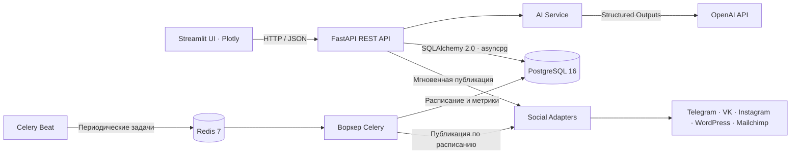

# AI Content Marketing Studio


-brightgreen?style=flat&logo=pytest&logoColor=white)
[](LICENSE)

Платформа для контент-маркетинга объединяет AI-генерацию месячного контент-плана, A/B-сравнение вариантов с Z-тестом, автопостинг в пяти каналах и сквозную аналитику показов, кликов и конверсий.

[Быстрый старт](#быстрый-старт) · [E2E-тесты](#e2e-тесты) · [Документация](#документация)

## Архитектура



## Сценарий работы

Маркетолог задаёт нишу и получает месячный план. Для публикации платформа генерирует два варианта с разными заголовками и призывами к действию. В Streamlit маркетолог выбирает вариант и публикует его сразу или ставит в расписание. Интерфейс показывает время в часовом поясе `Asia/Novosibirsk`.

1. **AI-генерация.** OpenAI Structured Outputs формирует месячную сетку и два варианта поста с разными заголовками и CTA. Без ключа, при исчерпании квоты или сетевой ошибке сервис использует встроенные шаблоны.
2. **Адаптеры каналов.** Telegram Bot API, VK Wall API, Instagram Graph API, WordPress REST API и Mailchimp Marketing API. При отсутствии ключа канала адаптер возвращает демонстрационный ID.
3. **Публикация по расписанию.** Celery Beat проверяет очередь каждые 30 секунд. Воркеры используют `SELECT … FOR UPDATE SKIP LOCKED`, чтобы параллельные задачи обрабатывали разные записи. Результат публикации и причина сбоя сохраняются в PostgreSQL.
4. **Аналитика A/B.** Сравнение показов, кликов, конверсий и CTR. При достаточной выборке двухвыборочный Z-тест пропорций определяет статистического победителя при `p < 0.05`. Демометрики помечены как `simulated`. Для боевых публикаций аналитика читает измеренные значения из базы.
5. **Учётные данные.** Настройки каналов хранятся на сервере в PostgreSQL в поле `credentials_json` типа JSONB. Клиент получает только режим готовности и имена ключей. Фильтр логов HTTPX скрывает запросы Telegram с токеном в URL.

## Быстрый старт

Команды рассчитаны на Windows PowerShell. Понадобятся Python 3.11+ и запущенный Docker Desktop с Docker Compose.

### 1. Инфраструктура

Из корня проекта запустите PostgreSQL 16 на порту 5432 и Redis 7 на порту 6379.

```powershell
docker compose up -d
```

### 2. Окружение и миграции

```powershell
python -m venv backend/.venv
.\backend\.venv\Scripts\python.exe -m pip install -r backend/requirements.txt -r frontend/requirements.txt
if (-not (Test-Path backend/.env)) { Copy-Item backend/.env.example backend/.env }
.\backend\.venv\Scripts\python.exe -m alembic -c backend/alembic.ini upgrade head
```

Для AI-генерации через OpenAI заполните `OPENAI_API_KEY` в `backend/.env`. Пустой ключ включает деморежим.

### 3. Бэкенд и веб-интерфейс

Из корня проекта запустите по одной команде в каждом из двух терминалов.

| Команда | Сервис |
| --- | --- |
| `.\start_backend.bat` | [FastAPI](http://127.0.0.1:8000/health) · [Swagger UI](http://127.0.0.1:8000/docs) |
| `.\start_frontend.bat` | [Streamlit](http://127.0.0.1:8501) |

### 4. Фоновые задачи

Для публикации по расписанию и обновления демометрик запустите воркер и Beat в отдельных терминалах из папки `backend`.

```powershell
.\.venv\Scripts\python.exe -m celery -A app.tasks.celery_app:celery_app worker --pool=solo --loglevel=INFO
.\.venv\Scripts\python.exe -m celery -A app.tasks.celery_app:celery_app beat --loglevel=INFO
```

## E2E-тесты

Тесты используют PostgreSQL и Redis. Каждый сквозной прогон создаёт временную схему `e2e_<uuid>` и отдельную очередь, затем удаляет их. Генерация и отправка выполняются в деморежиме.

```powershell
cd backend
.\.venv\Scripts\python.exe -m pytest tests/test_e2e_pipeline.py -v
```

**Контрольный прогон прошёл на 100% (6 из 6 тестов).** Сквозной сценарий проверяет `/health`, создание контент-плана, генерацию и выбор A/B-варианта, мгновенную и отложенную публикацию, воркер Celery и аналитику. Пять отдельных тестов проверяют деморежим адаптеров Telegram, VK, Instagram, WordPress и Mailchimp.

## Документация

- [Бизнес-кейс и расчет окупаемости (ROI) · BUSINESS_CASE.md](BUSINESS_CASE.md)
- [Техническое задание «ТЗ_AI_Платформа_Контент_Маркетинга.docx»](TZ_AI_Content_Marketing_Studio.docx)
- [Боевая настройка соцсетей и фоновых задач · PUBLISHING.md](backend/PUBLISHING.md)
- [Пример конфигурации бэкенда](backend/.env.example)
- [Сквозные тесты](backend/tests/test_e2e_pipeline.py)

## Лицензия

Проект распространяется по лицензии MIT. Copyright © 2026 Alexey Khanipov. [Текст лицензии](LICENSE)
